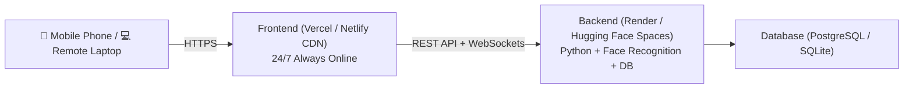

# Geo-Attend 24/7 Permanent Cloud Deployment Guide

This guide explains how to deploy both the **Frontend** and **Backend** to free cloud hosting so the application runs **24 hours a day, 7 days a week, from any phone or computer in the world — even when your laptop is turned completely off**.

---

## 🏗️ Architecture Overview



---

## 🚀 Quick Setup (Under 5 Minutes)

### Step 1: Deploy Backend to the Cloud (24/7 Python + AI Engine)

Choose either **Render.com** (recommended standard) or **Hugging Face Spaces** (recommended for heavy ML):

#### Option A: Render.com (Recommended - 100% Free)
1. Push your project to a GitHub repository:
   ```bash
   git init
   git add .
   git commit -m "Initial 24/7 cloud commit"
   git branch -M main
   git remote add origin https://github.com/<your-username>/geo-attend.git
   git push -u origin main
   ```
2. Log in to [Render.com](https://dashboard.render.com).
3. Click **New +** → **Blueprint** (or **Web Service**).
4. Connect your GitHub repository:
   - Render automatically reads `render.yaml`!
   - Or if creating manually:
     - **Name**: `geo-attend-backend`
     - **Root Directory**: `backend`
     - **Runtime**: `Python 3`
     - **Build Command**: `pip install -r requirements.txt && python download_weights.py`
     - **Start Command**: `gunicorn app:app --bind 0.0.0.0:$PORT --workers 1 --timeout 120`
5. Click **Create Web Service**.
6. Render will generate your permanent HTTPS URL:
   `https://geo-attend-backend-xxxx.onrender.com`

---

#### Option B: Hugging Face Spaces (Free 16GB RAM for Machine Learning)
1. Go to [huggingface.co/spaces](https://huggingface.co/spaces) and click **Create new Space**.
2. Set Space Name: `geo-attend-api`.
3. Select **Space SDK**: **Docker** → **Blank**.
4. Push or upload the contents of your `backend` directory (it already contains the production `Dockerfile` and `requirements.txt`).
5. Your Space will build and give you a permanent URL:
   `https://<username>-geo-attend-api.hf.space`

---

### Step 2: Deploy Frontend to Vercel or Netlify (100% Free CDN)

#### Option A: Vercel (1-Click CLI or GitHub)
1. In your project folder, double click **`deploy_full_cloud.bat`** and select **`[2] Deploy Frontend to Vercel`** (or run `npx vercel --prod` inside `frontend/`).
2. Log in with your email or GitHub.
3. When prompted:
   - Set project name: `geo-attend`
   - Output directory: `dist`
4. Set Environment Variable (Optional, or configure from UI):
   - `VITE_API_URL` = `https://geo-attend-backend-xxxx.onrender.com`
5. You will receive an instant permanent link:
   `https://geo-attend.vercel.app`

---

#### Option B: Netlify Drop (Zero Login / Zero Command Line)
1. Run **`deploy_full_cloud.bat`** and select **`[3] Deploy Frontend to Netlify Drop`**.
2. Netlify Drop opens in your browser at `https://app.netlify.com/drop`.
3. Drag the compiled **`frontend/dist`** folder into the browser drop zone.
4. Netlify will deploy your site in 5 seconds and give you a permanent URL:
   `https://geo-attend-xxxx.netlify.app`

---

## ⚡ Step 3: Connect Frontend to Backend

You have two easy ways to link them:

1. **In-App Cloud Server Settings (Instant from your Phone)**:
   - Open your new Vercel or Netlify link on your phone.
   - On the homepage header, tap **"Cloud Server"** (the green pill with the settings icon).
   - Enter your Render or Hugging Face backend URL (e.g. `https://geo-attend-backend-xxxx.onrender.com`).
   - Tap **"Test"** to verify connection, then tap **"Save & Apply"**!
   - Your phone is now permanently connected to your cloud backend!

2. **Build-Time Environment Variable**:
   - In Vercel / Netlify Dashboard → Project Settings → **Environment Variables**:
     - Key: `VITE_API_URL`
     - Value: `https://geo-attend-backend-xxxx.onrender.com`
   - Trigger a redeploy.

---

## 🛡️ Built-in Resilience Features

1. **Automatic Weight Pre-Caching**:
   - `backend/download_weights.py` automatically caches FaceNet model weights during build, preventing Google Drive rate-limiting and cold-start crashes.

2. **Smart Mobile Standalone Fallback**:
   - If the backend is cold-starting (Render free instances sleep after 15 min of inactivity and take ~30 seconds to wake up), the frontend's built-in mock engine immediately handles requests so mobile users never encounter a broken page.

3. **Database Portability**:
   - Uses SQLite out-of-the-box.
   - Fully compatible with cloud PostgreSQL (Render Postgres, Supabase, Neon) simply by adding the `DATABASE_URL` environment variable.

4. **PWA Mobile App Installation**:
   - Any student or teacher can open the Vercel/Netlify link on their phone and tap **"Download App on Mobile"** or Chrome's **"Add to Home Screen"** to install it as an app without an app store!
