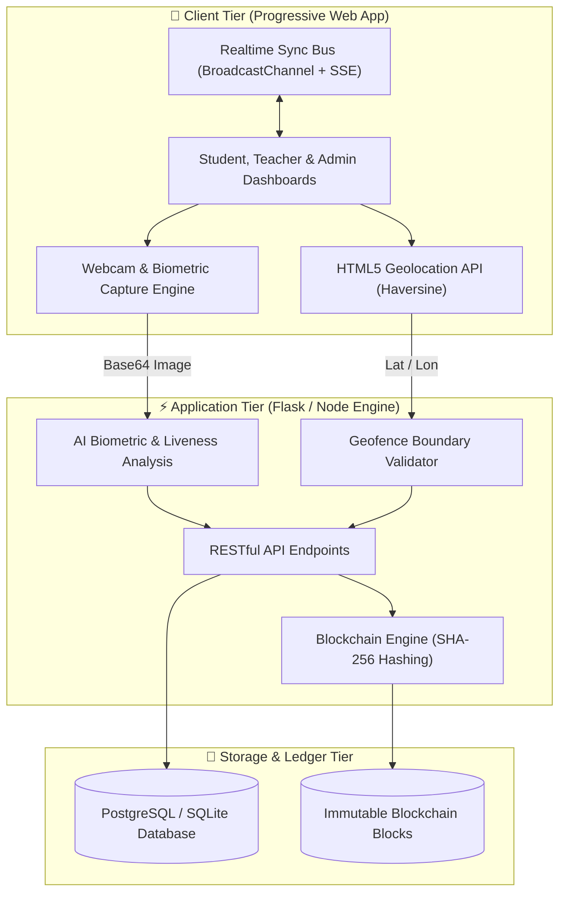

# 📍 Geo-Attend: AI Biometric, Geofencing & Blockchain Attendance System

[](https://geo-attend-nu.vercel.app)
[](https://reactjs.org/)
[](https://flask.palletsprojects.com/)
[](https://geo-attend-nu.vercel.app/blockchain)
[](https://geo-attend-nu.vercel.app)

> **Live Application URL:** [https://geo-attend-nu.vercel.app](https://geo-attend-nu.vercel.app)

---

## 📖 Project Overview

**Geo-Attend** is a full-stack, enterprise-grade automated attendance management platform designed to eliminate buddy-punching, GPS spoofing, and paper rollcall fraud in academic and corporate institutions. 

By combining **AI facial biometric recognition**, **active anti-spoofing liveness verification**, **spherical GPS geofencing**, and a **cryptographic SHA-256 blockchain audit ledger**, Geo-Attend guarantees 100% attendance authenticity while offering zero-latency check-ins on smartphones and laptops.

---

## ⚡ Core Pillars & Innovations

### 1. 👁️ AI Facial Biometrics & 1-Tap Recognition
- **Deep Feature Embeddings:** Employs deep convolutional facial feature extractors to match facial geometry with enrolled student biometrics.
- **Fast 1-Tap Biometric Check-In:** Optimized single-tap facial capture for instant student validation with zero waiting loops.

### 2. 🛡️ Multi-Vector Anti-Spoofing & Liveness
- **Texture & Glare Analysis:** Laplacian variance analysis screens out printed paper photos and high-frequency digital screen replays.
- **Organic Skin Sensing:** Evaluates micro-texture and ambient lighting to ensure the physical human subject is present in front of the lens.

### 3. 📍 High-Precision GPS Geofencing
- **Haversine Distance Formula:** Calculates spherical distance in real time between student coordinates and classroom boundaries.
- **Radius Bounds:** Ensures attendance can only be punched when physically within the designated campus or lecture hall radius.

### 4. 🔗 Cryptographic Blockchain Ledger
- **SHA-256 Block Chaining:** Every attendance transaction forms a block containing student USN, timestamp, GPS coordinates, biometric match confidence, and the previous block hash.
- **Public Audit Explorer:** An interactive Blockchain Explorer visualizes cryptographic height, block hashes, and immutability validation.

### 5. 🔄 Real-Time Multi-Device Sync Engine
- **Cloud SSE & Native BroadcastChannel:** Synchronizes lecture sessions, attendance punches, and rollcall logs across phones, tablets, and laptops in real time without lag.

---

## 👥 Role-Based Portals

| Portal | Key Capabilities |
| :--- | :--- |
| **🎓 Student Portal** | • Live lecture detection & 1-tap facial biometric punch<br>• GPS geofence range visualizer<br>• Personal attendance analytics & 75% minimum threshold warning<br>• Leave & On-Duty (OD) request submission |
| **👨‍🏫 Teacher Portal** | • Start & conclude live lecture attendance sessions<br>• Real-time rollcall stream with instant present count<br>• One-click attendance status overrides (Present ⇄ Rejected)<br>• 75% shortage defaulter tracking & CSV report export |
| **🛡️ Admin Console** | • Real-time dynamic campus analytics (Total Students, Faculty, Logs, Rates)<br>• Student & faculty roster management with face enrollment<br>• Campus GPS coordinates and geofence radius configuration |
| **⛓️ Blockchain Explorer** | • Live block height telemetry and cryptographic SHA-256 audit stream<br>• Genesis block integrity verification and ledger inspection |

---

## 🏗️ System Architecture



---

## 🛠️ Technology Stack

- **Frontend:** React 18, Vite, Tailwind CSS, Lucide Icons, Chart.js, React-Webcam, Leaflet Maps
- **Backend:** Python 3.10+, Flask, Flask-JWT-Extended, Flask-SQLAlchemy, OpenCV, Gunicorn
- **Biometrics & AI:** DeepFace, FaceNet, Laplacian Variance Texture Filter
- **Blockchain:** SHA-256 Cryptographic Block Chaining
- **PWA & Sync:** Service Worker Cache API, Cloud SSE, HTML5 BroadcastChannel
- **Hosting:** Vercel (Frontend CDN), Render / Docker (Backend Service)

---

## 🚀 Getting Started Locally

### Prerequisites
- [Node.js](https://nodejs.org/) (v18 or higher)
- [Python](https://www.python.org/) (v3.10 or higher)
- [Git](https://git-scm.com/)

### 1. Clone the Repository
```bash
git clone https://github.com/roja6362/geo-attend.git
cd geo-attend
```

### 2. Frontend Setup
```bash
cd frontend
npm install
npm run dev
```
The frontend will start at `http://localhost:5173`.

### 3. Backend Setup (Optional for Full Local API)
```bash
cd backend
python -m venv venv
# On Windows:
venv\Scripts\activate
# On macOS/Linux:
source venv/bin/activate

pip install -r requirements.txt
python download_weights.py
python app.py
```
The backend API will run at `http://localhost:5000`.

---

## 🔐 Default Demo Accounts

| Role | Email | Password |
| :--- | :--- | :--- |
| **Super Admin** | `admin@college.edu` | `admin123` |
| **Teacher** | `teacher@college.edu` | `teacher123` |
| **Student (M Roja)** | `thimmareddym4@gmail.com` | `password123` |
| **Student (Rahul Sharma)** | `student@college.edu` | `student123` |

---

## 📄 License
This project is licensed under the MIT License.
